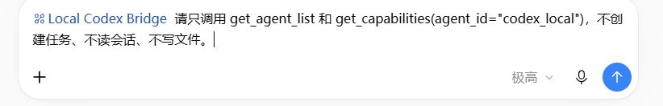
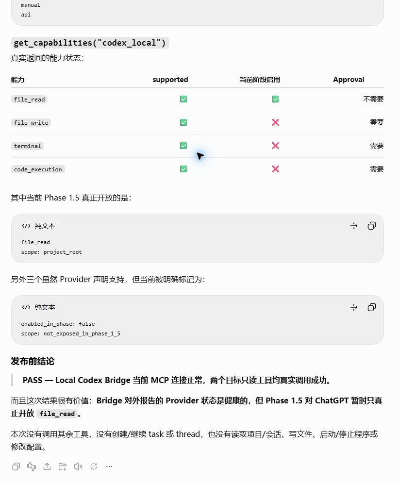
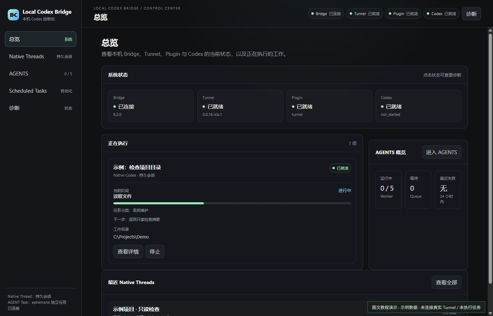
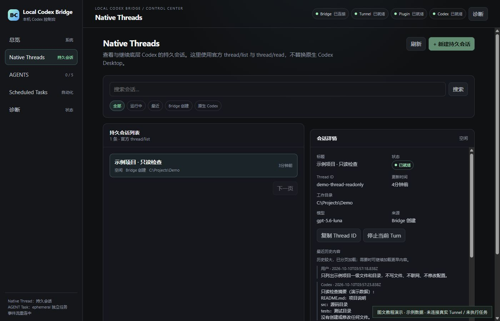
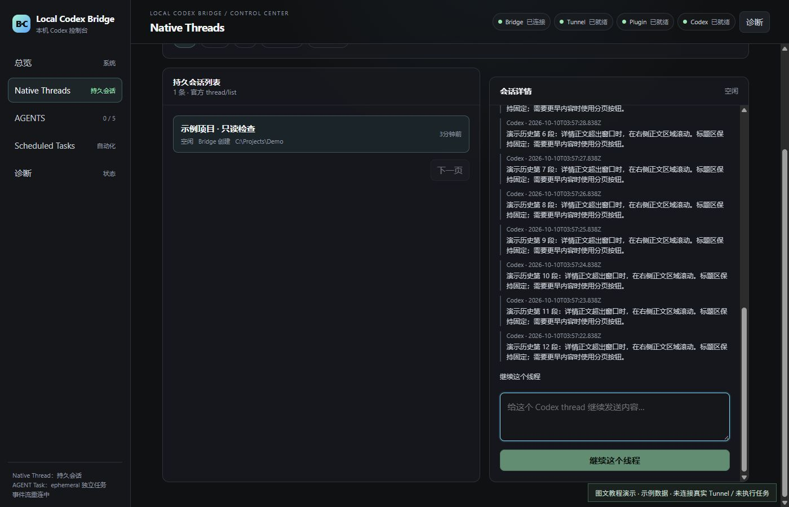
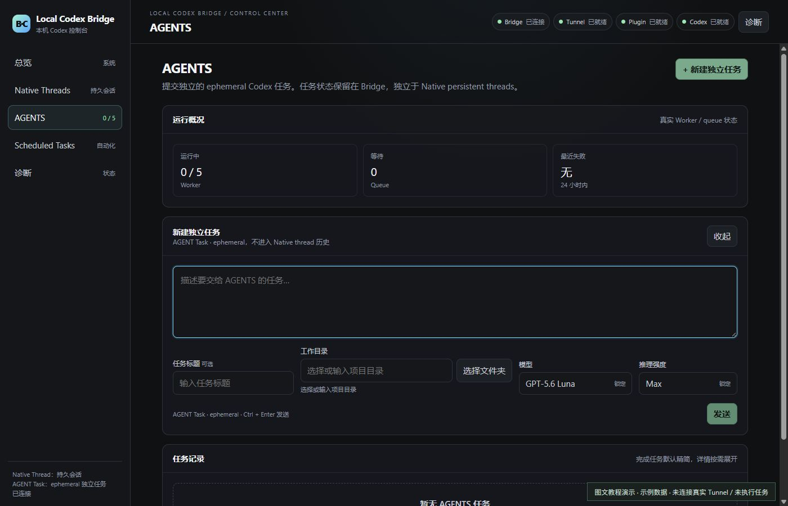
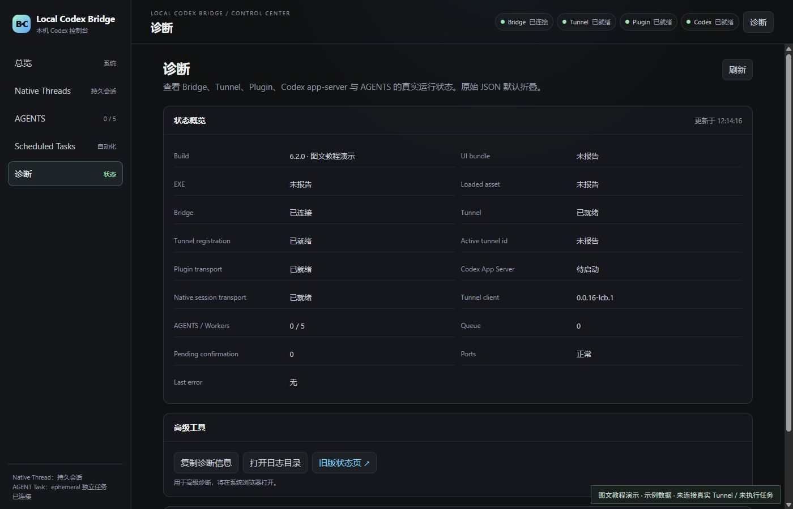

# 图文操作：ChatGPT 调用 Codex 与 Bridge 控制中心

适用：Local Codex Bridge 6.2.0，Windows x64。先完成 [小白安装与首次配置](START-HERE.zh-CN.md)，再照这里操作。

这不是“把截图里的账号、路径和连接信息抄进去”。每位用户必须使用自己的 Codex 登录、Tunnel 和真实项目目录。本版本 Agent Gateway 仅开放只读 `file_read`，不能根据 Provider 声明支持就认为写文件、terminal 或 code_execution 已开放。

## 图片说明：真实记录与演示必须分开

- **图 1、图 2：真实 ChatGPT 网页操作。** 展示选择插件和填写只读指令；输入框里的示例没有发送，不能当作任务执行成功证据。
- **图 3：此前实际只读调用的成功记录。** 这是历史记录，不是本轮新执行的任务，也不证明读项目、写文件或控制一个 Native Turn 成功。
- **图 4～图 8：真实发布版前端 + 独立演示数据。** 页面来自 6.2.0 的界面代码，截图角落标有“图文教程演示”。没有连接真实 Tunnel，没有执行 Codex，没有读取私人会话；示例状态和内容只说明按钮位置及布局。
- 图片已排除私人侧栏、账号、项目标题、实际用户路径、真实 Thread ID 和密钥。`C:\Projects\Demo` 与 `demo-thread-readonly` 都是演示值，不是可直接复制使用的真实项目/线程。

## 第一步：在 ChatGPT 选择 Bridge

先在电脑上打开桌面 **Local Codex Bridge**，诊断里确认 Tunnel / registration / Plugin transport 已就绪。

然后在 ChatGPT 网页新建对话，在输入框输入 `@Local`，点击 **Local Codex Bridge**。不要选名称相近的文件搜索结果。首次还需按 [连接步骤](START-HERE.zh-CN.md#5-在-chatgpt-连接) 安装/连接自己创建的插件，账号没有入口时先解决权限问题。


成功标志：输入框中出现 **Local Codex Bridge** 的插件标识。只是打出名字、看到历史消息或者软件窗口打开，都不等于工具已可调用。

## 第二步：先做只读连接检查

选中插件后，复制下面这条。图 2 只展示输入位置，实际验证时由你确认后发送：

```text
请实际调用 get_agent_list 和 get_capabilities(agent_id="codex_local")。
报告真实返回的 Agent 数量、状态、能力与 enabled_in_phase。
不创建任务、不读取项目或会话、不写文件、不修改配置。
如果工具不存在或连接失败，报告原始错误，不把文字分析当成调用成功。
```



下面是此前真实工具调用后的记录，可参考返回结果的阅读方式：



成功标志：两个工具有真实返回，而不是 `BLOCKED_BEFORE_CALL`、`Session terminated`、404 或泛泛地说“连接正常”。

结果中 `supported` 是 Provider 的声明；`enabled_in_phase` 才表示当前 Gateway 开放。图中只有 `file_read` 开放，另外三项需要更高级的授权与实现，本发行版不提供绕过方式。

## 第三步：让 ChatGPT 提交一个有边界的本地任务

**这一步真的会调用 Codex，可能消耗额度并产生 Bridge 任务记录。** 先确认自己的项目已经存在并按 [使用手册](USER-GUIDE.zh-CN.md) 注册。不要操作 Bridge 的安装目录或把整个用户目录当项目。

在已选中插件的对话中，可以这样要求：

```text
先调用 list_projects，不读取项目文件。
列出可用项目名称和 project_id，让我选择一个真实项目。
不要自行创建目录、选择别的项目或提交任务。
```

你选择并授权一个返回的真实项目后，再发送：

```text
使用刚才我确认的 project_id，创建 Codex Agent 只读任务：
只列出项目根目录的一级文件和文件夹，不递归、不联网、不修改任何文件。
调用 create_agent_task，并返回真实 task_id。
再用 get_task_status 查询同一个 task_id，报告当前阶段和最终 result manifest。
如果需要授权或执行失败，停在真实状态，不自动扩大权限或换项目。
```

不要把“已接受任务”当“任务完成”。完成时检查终态、输出摘要与 result manifest；不能只凭百分比、Provider 的能力声明或 ChatGPT 的普通文字总结认定成功。遇到需要处理/中断/失败，按手册查看详情，不能假称任务仍在执行。

**本图解没有为截图额外创建真实任务。** 图 4 的 Native 执行卡是演示数据，不是上面 `create_agent_task` 的运行结果。两个入口的任务类型不能混淆。

## 第四步：在 Bridge 总览监督执行



看三个位置：

1. **系统状态**：Bridge、Tunnel、Plugin、Codex。Codex lazy-ready 是健康的等待启动，不能据此说已经执行了任务。
2. **正在执行**：真实 active 任务和阶段。没有真实进度时显示阶段，不把动画轨道当百分比；queued、需要处理、完成、失败等不应当作正在执行。
3. **任务类型**：Native 是持久会话；AGENTS 是 ephemeral 独立任务。`create_agent_task` 的 Agent Gateway 任务不能仅凭名称猜成 Native Thread。

点 **查看详情** 看对应任务/线程。点 **停止/取消** 是实际任务控制，不是清理历史；仅在你确实希望结束该任务时操作。

## 第五步：查看 Native 持久会话与长历史

进入左侧 **Native Threads**，选择一条真实会话。这里只管理底层 persistent thread，不会替你强制打开或重启原生 Codex Desktop。



右侧 **会话详情** 正文有自己的纵向滚动条。把鼠标放在正文区域，滚轮/触控板向下滑；标题区保留在详情卡上方。大历史按页读取，需要时点击 **加载更早内容**，不把整份 session 一次塞进界面。



**继续这个线程** 会续写所选的同一个 thread，不是新建线程，也不是只读查看。发送前核对当前标题、工作目录和 Thread ID，不要误把示例 ID 当自己的线程。

## 第六步：必要时才在 AGENTS 手动提交独立任务

左侧 **AGENTS → + 新建独立任务** 才打开输入区，Dashboard 不常驻 Composer。



- 输入任务描述；任务标题可选。
- **工作目录** 是真实项目目录，不是保存位置。Windows 桌面版点 **选择文件夹** 可以使用原生目录选择器；本图的浏览器演示不包含 WinForms 宿主，不能用它证明原生 Picker 被打开。
- 目录为空是正常初始状态；发送前必须选择有效目录。
- 模型 **GPT-5.6 Luna**、推理强度 **Max** 当前固定，只读展示，不代表有多个可选项。
- 独立任务结束后看详情、执行事件、输出与错误；进程丢失的 ephemeral 任务不能假称无损继续执行。

## 第七步：出错时看诊断，不清空数据



先核对 Bridge、Tunnel、registration、Plugin transport、Codex 和最后错误。**图 8 的 ready 是示例数据，不是你的连接状态。**

- **旧版状态页** 在系统浏览器打开，不替换 Bridge 主界面。
- **查看原始 JSON** 只在排错时展开；公开前必须检查是否含实际路径、Thread ID、日志和连接元数据，不直接整段上传。
- 连接失败先查运行状态、账号权限和自己的 Tunnel 绑定，不删除 `.codex`、sessions、history，不关闭原生 Codex 或系统防护。

## 日常使用只记住四句话

1. 桌面打开 Bridge；右上角状态正常后，在 ChatGPT 选择自己的插件。
2. 先只读检查，再给 Codex 明确项目和任务边界。
3. 接受、运行、完成是三回事；用真实 task_id / thread_id 查对应结果。
4. 点 X 是缩到托盘；真正不用时从托盘菜单退出 Bridge。不要删原生会话数据来排错。

完整参考：[安装教程](START-HERE.zh-CN.md)、[使用手册](USER-GUIDE.zh-CN.md)、[可复制指令](CHATGPT-PROMPTS.zh-CN.md)、[隐私边界](PRIVACY-RELEASE.zh-CN.md)。

## 截图审查与版本说明

图片在 2026-10-10 采集并逐张人工检查；只保留教程必须的页面区域，不包含浏览器地址栏、个人侧栏、账号菜单、真实项目数据或运行 key。截图来源、SHA256 与大小见 [截图清单](docs/images/quickstart/SCREENSHOTS.json)。

ChatGPT 界面会更新，按钮位置和文案可能随账号、语言、工作区变化；以自己页面和 [OpenAI 官方连接步骤](https://developers.openai.com/plugins/deploy/connect-chatgpt) 为准。本指南为发布后在线文档补充，原 v6.2.0 的 tag、Windows ZIP 与源码 ZIP 没有被替换；旧 ZIP 内没有本次新图解，最新说明以仓库 main 为准。
